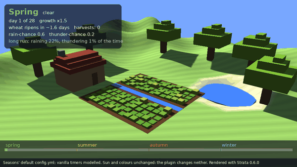

# Seasons

## Description

Seasons is a Minecraft plugin that gives a server a year. Spring, summer, autumn and winter advance on a configurable calendar, and each one changes how the world behaves — what weather rolls in, how fast crops grow, and how long the days run.

It exists because a survival server that runs for months has no sense of elapsed time. Every day is the same day. A season that a player can feel — a hard winter where the wheat crawls and the rain turns to snow — turns "how long have we been here" into something the world answers on its own.

This plugin was proposed from a Kingdom: First Era player request on 2026-09-04.

### Preview: a year of the default config

<picture>
  <source media="(prefers-reduced-motion: reduce)" srcset="docs/images/seasons-year-poster.png">
  
</picture>

*One year of the default `config.yml` (four 28-day seasons, growth x1.5 / x1.0 / x0.75 / x0.25) played over a wheat field at two steps a day, rendered headless with [Strata](https://github.com/Preponderous-Software/strata) 0.6.0 by [`scripts/preview/render_year.py`](scripts/preview/render_year.py). The calendar and multipliers are read from the config file, and each growth step goes through a copy of `GrowthPolicy.stagesFor`. The vanilla side is modelled, not recorded: a hydrated wheat field gets about 17.6 random ticks a day and grows on one in six. The sun (Strata's solar position at 15:00, 40° N, each season laid over the matching quarter of 2026) and the colours are decoration; Seasons does not change day length or weather yet, and nothing advances the date yet, so this shows what the calendar will do once it does.*

## Project Status

**Pre-implementation.** The plugin loads a configurable four-season calendar and keeps the current date across restarts, and scales crop growth by the current season, but nothing advances the date yet, so the season only changes if `calendar.yml` is edited. The scope of the first release is defined in [MVP.md](MVP.md) — read that before opening a pull request, because it says as much about what v1 will *not* do as what it will.

## Planned Features

- A configurable year divided into four seasons
- Per-season weather bias — snow in winter, storms in autumn
- Per-season crop growth rates
- Per-season day length
- A command to read the current season and date, and an admin command to set it

## Installation

Not yet released. Once there is a release, installation will follow the usual DPC pattern: drop the jar in `plugins/` and restart. It will also be available through [Dan's Plugin Manager](https://github.com/Dans-Plugins/Dans-Plugin-Manager).

### Building from source

Building requires JDK 21. The plugin is compiled for Java 17, so it still runs on the oldest supported server.

```bash
./gradlew clean build
```

The jar is written to `build/libs/Seasons-<version>.jar`.

### Dependencies

None. Seasons is intended to stand alone.

## Usage

### Documentation

- [MVP](MVP.md) – Scope of the first release, and its deliberate non-goals
- [Configuration](CONFIG.md) – Every `config.yml` key, including the per-season growth multipliers, and the saved calendar file

`USER_GUIDE.md`, `COMMANDS.md` and `CHANGELOG.md` land with the first release, per [DOCUMENTATION_PRACTICES.md](https://github.com/Dans-Plugins/dpc-conventions/blob/main/docs/DOCUMENTATION_PRACTICES.md).

## Support

You can find the support Discord server [here](https://discord.gg/xXtuAQ2).

### Experiencing a bug?

Please fill out a bug report [here](https://github.com/Dans-Plugins/Seasons/issues/new).

## Contributing

This repository follows the standards in [dpc-conventions](https://github.com/Dans-Plugins/dpc-conventions). The build tooling is in place; `CONTRIBUTING.md` has not been written yet.

## License

This project is licensed under the [GNU General Public License v3.0](LICENSE).

See the [LICENSE](LICENSE) file for full details.
